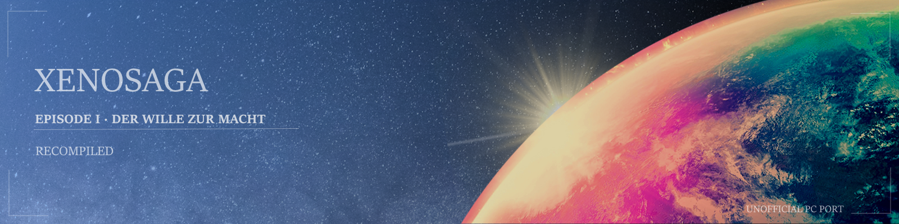
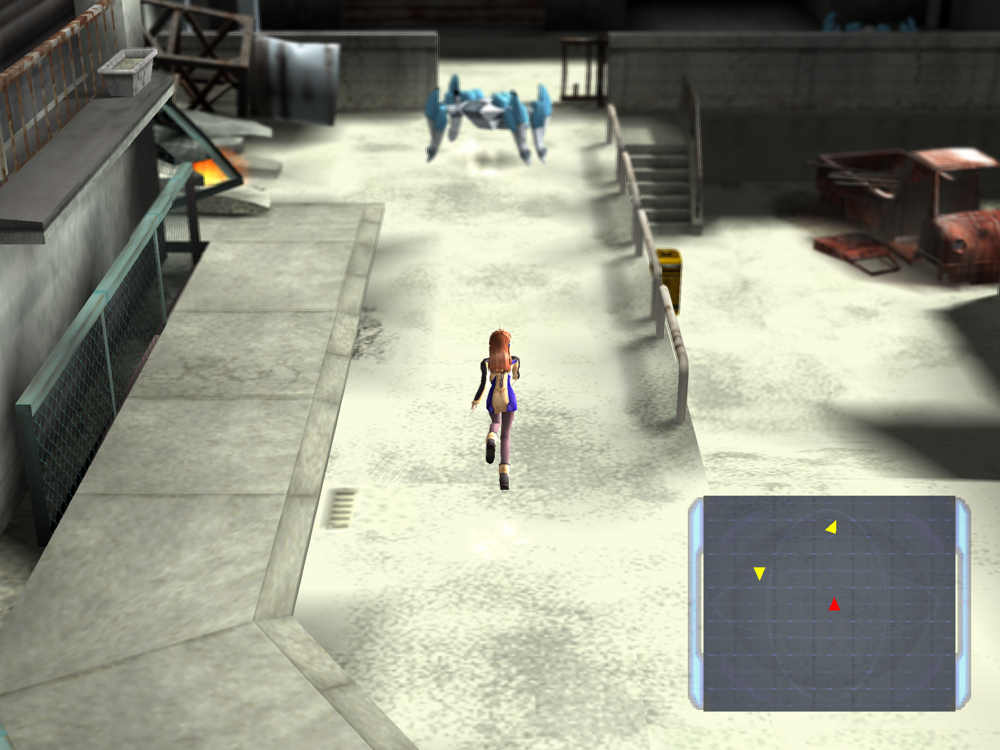
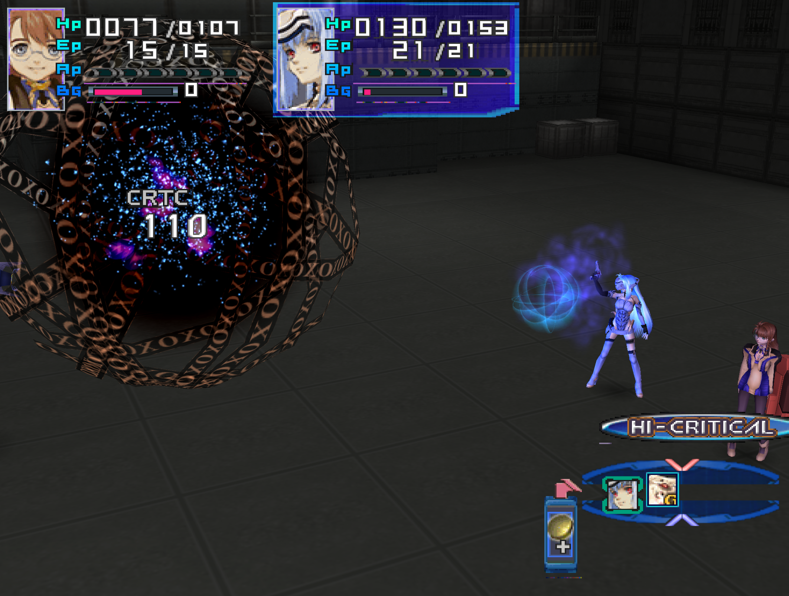
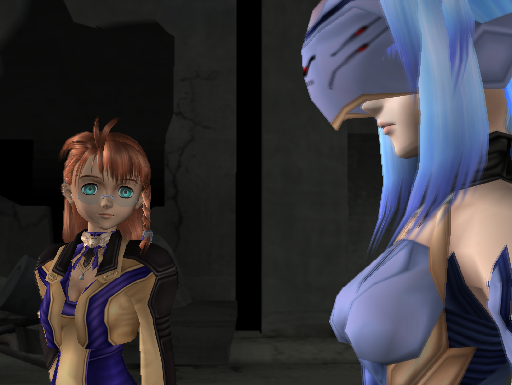
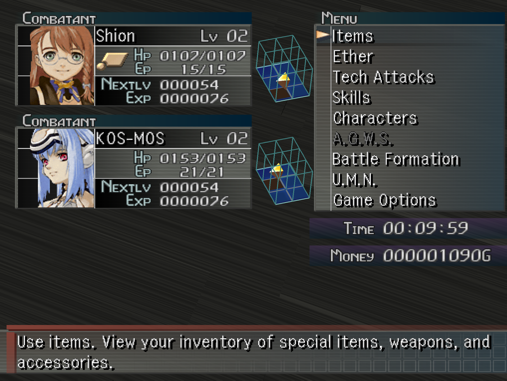

# Xenosaga Episode I: Recompiled

  

  
  
  

An unofficial native PC port of **Xenosaga Episode I: Der Wille zur Macht**, built using [PS2Recomp](https://github.com/ran-j/PS2Recomp).

Originally developed by [BeyondNeteros](https://github.com/BeyondNeteros/xenosaga-recomp-FREE-TO-USE), this fork continues development of the port.

The goal is to make Xenosaga Episode I playable on modern PCs with good performance, improved graphics, and support for modern hardware.

> **Work in progress.** The game is playable in tested early-game areas, but a complete playthrough has not yet been validated.

## Screenshots

<table>
  <tr>
    <td align="center"> Exploration</td>
    <td align="center"> Combat</td>
  </tr>
  <tr>
    <td align="center"> In-engine cinematic</td>
    <td align="center"> Game interface</td>
  </tr>
</table>

*Screenshots from a development build of the native PC port.*

## Current Status

| Component | Status |
|---|---|
| Game recompilation | Working |
| Boot and disc access | Working |
| Menus and cinematics | Working |
| Exploration and battles | Tested in early-game areas |
| Audio | Working, with synchronization issues |
| Keyboard and controller | Supported |
| GPU rendering | Supported |
| Resolution scaling | Supported |
| Widescreen | Experimental |
| Full-game compatibility | Untested |

## Features

- Native Windows x64 execution
- GPU-accelerated OpenGL rendering
- Adjustable internal resolution
- Fullscreen and experimental widescreen support
- Keyboard and controller input
- Battle fast-forward and optional gameplay settings
- Built-in FPS counter and screenshot capture

## Getting Started

### Requirements

- Xenosaga Episode I (USA, `SLUS-20469`) in ISO format
- Windows 10 or 11 (64-bit)
- AVX2-capable processor
- Approximately 10 GB of available storage
- OpenGL 4.5 with fragment shader interlock for GPU rendering

A CPU renderer is available for systems without compatible graphics hardware.

### Installation

1. Download the repository.
2. Open `Xenosaga Launcher.bat`.
3. Select your disc image.
4. Install the build tools.
5. Select **Build the game**.
6. Once the build finishes, select **PLAY**.

The launcher generates and compiles the game code locally. Build times depend on your hardware.

Automatic tuning is skipped when no training recording is available. For better performance, play through some gameplay areas and battles, close the game, then select **Optimize** in the launcher. This compiles native VU1 blocks collected locally during play. Repeat as you explore new areas.

If the standard Windows build tools fail to install, see the alternative [WSL2 build guide](docs/BUILD_WSL.md).

Your original disc image is required to play.

## Controls

| Keyboard | PS2 |
|---|---|
| WASD / Arrow keys | Movement |
| X / Space | Cross |
| C / Esc / Backspace | Circle |
| Z | Square |
| V | Triangle |
| Q / E | L1 / R1 |
| Shift | L2 / R2 |
| Enter | Start |
| Tab | Select |

| Shortcut | Function |
|---|---|
| F3 | FPS counter |
| F4 | Scaling filter |
| F5 | Aspect ratio |
| F11 / Alt+Enter | Fullscreen |
| F12 | Screenshot |

Controllers are also supported.

Graphics, audio, and gameplay options can be configured through `settings.ini` next to the game executable.

## Known Issues

- Low frame rates in demanding areas and cutscenes.
- Audio desynchronization during in-engine cutscenes.
- Occasional texture, shadow, and geometry artifacts.
- Screen shaking in some scenes at native resolution.
- Stretched HUD and menus in widescreen mode.
- Limited hardware compatibility testing.

## Roadmap

- [ ] Stable 30 FPS gameplay
- [ ] Further native VU1 optimization
- [ ] GS rendering optimization
- [ ] Graphics accuracy improvements
- [ ] Audio synchronization fixes
- [ ] Improved widescreen support
- [ ] Improved installation process
- [ ] Full-game compatibility testing

## Development

The port uses static recompilation to translate the original PS2 executable and its five code overlays into native host code.

It currently targets PS2Recomp commit `e563698` with the modifications in `patches/ps2recomp-runtime.patch`.

| Directory | Contents |
|---|---|
| `src/` | Game-specific hooks and overrides |
| `tools/` | Build and diagnostic utilities |
| `patches/` | PS2Recomp runtime modifications |
| `launcher/` | Windows launcher |
| `dist/` | Runtime launch scripts |

### Developer Documentation

- [Development Guide](docs/DEVELOPMENT.md)
- [WSL2 Build Guide](docs/BUILD_WSL.md)
- [VU1 Performance and Validation](docs/VU1_PERFORMANCE.md)
- [Changelog](CHANGELOG.md)

## Contributing

Contributions and bug reports are welcome.

- [Contribution Guide](CONTRIBUTING.md)
- [Development Issues](https://github.com/gwencrow/xenosaga-recomp/issues)
- [Code of Conduct](CODE_OF_CONDUCT.md)

When reporting an issue, please include your hardware specifications, operating system, graphics settings, build version, and steps to reproduce it.

Do not upload game files, generated game code, memory dumps, or other proprietary game data.

## Credits

- [BeyondNeteros](https://github.com/BeyondNeteros): Original port development
- [PS2Recomp](https://github.com/ran-j/PS2Recomp): Recompilation framework
- [FFmpeg](https://ffmpeg.org/): Multimedia decoding

## Image Credits

Gameplay screenshots show Xenosaga Episode I and are included to document the port. The underlying game imagery belongs to its respective rights holders. The custom banner incorporates third-party stock imagery under its applicable licenses. Third-party imagery is not covered by the software GPLv3 license.

## License

Copyright (C) 2026 BeyondNeteros and contributors.

The code in this repository (the port code, launcher, tools and the
PS2Recomp runtime patch) is free software: you can redistribute it and/or
modify it under the terms of the **GNU General Public License, version 3**
(see [`LICENSE`](LICENSE)), the same license as
[PS2Recomp](https://github.com/ran-j/PS2Recomp), which this port builds on and
patches. Parts of the movie decoder's MPEG tables come from FFmpeg
(LGPL 2.1 or later), credited in that file.

The license covers this project's own code only:

- **Xenosaga Episode I is not included and not licensed here.** The game, its
  code, data, movies and audio, and anything generated from them (such as the
  recompiled C++ the launcher builds on your PC), belong to their owners
  (Bandai Namco / Monolith Soft). You need your own copy of the game. Don't
  share game files or builds that contain them.
- The game decompilation used as a reference during development is not part
  of this repository and is not covered by this license.

This is an unofficial fan project and is not affiliated with Bandai Namco
or Monolith Soft.
